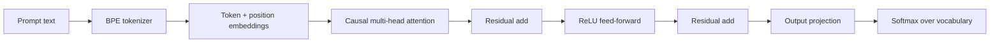

<div align="center">

# Micro-Transformer

**A decoder-only Transformer built from scratch in NumPy, with a BPE tokenizer, hand-written backpropagation, Adam, and a live attention visualizer.**

[


](https://github.com/VaibhavSingh557/micro-transformer/actions/workflows/tests.yml)


</div>

---

No PyTorch. No TensorFlow. No autograd. Every forward and backward operation in this project is written out by hand, and every gradient is verified against finite differences in the test suite.

The goal is clarity: you can read `micro_transformer/model.py` top to bottom and see exactly how attention, causal masking, residual connections, and gradient descent fit together.

## Highlights

- **BPE tokenizer** trained from scratch, with deterministic tie-breaking and a round-trip-tested `decode`
- **Causal multi-head self-attention** with an explicit mask, visible in the dashboard
- **Manual backpropagation** through attention, the feed-forward block, residual connections, and the output head
- **Gradient checking:** analytic gradients are compared with central finite differences for every parameter tensor
- **Adam optimizer** implemented from the update equations
- **Interactive dashboard:** attention heatmap per head, subword tokens with IDs, greedy completion, and next-token probabilities
- **JSON API** at `POST /api/forward` for programmatic access
- **Hardened local server:** binds to `127.0.0.1` by default, caps request size and prompt length, and returns JSON errors

## Architecture



Forward pass, in equations (one block):

```
X      = E[tokens] + P[positions]
H1     = X + MaskedAttention(X) @ Wo
H2     = H1 + ReLU(H1 @ W1 + b1) @ W2 + b2
logits = H2 @ Wout + bout
```

| Setting | Default |
|---|---|
| Model width (`d_model`) | 32 |
| Attention heads | 4 |
| Feed-forward width (`d_ff`) | 64 |
| Max context length | 48 tokens |
| Training | Adam, lr 0.01, 600 epochs |
| Parameters | about 15k, depending on the corpus |

## Quick start

Requires Python 3.9+.

```bash
git clone https://github.com/VaibhavSingh557/micro-transformer.git
cd micro-transformer

python -m venv .venv
source .venv/bin/activate          # Windows: .venv\Scripts\activate

pip install -r requirements.txt
python -m unittest -v              # run the test suite
python main.py                     # train, then open http://127.0.0.1:5095
```

Command-line options:

| Flag | Default | Purpose |
|---|---|---|
| `--port` | `5095` | Port to serve on |
| `--epochs` | `600` | Training epochs |
| `--host` | `127.0.0.1` | Interface to bind |
| `--no-browser` | off | Don't open a browser tab |

## Using the dashboard

1. Type a prompt such as `neural attention layers`.
2. Click **Run forward pass**.
3. Read the results:
   - **Heatmap:** the lower-triangular attention weights for the chosen head. The upper triangle is masked, so each token attends only to itself and earlier tokens.
   - **Tokens:** the BPE pieces and their IDs.
   - **Completion:** the greedy continuation, with the prompt shown in plain text and the generated part in bold.
   - **Probabilities:** the top five next-token candidates.

## API

```bash
curl -s -X POST http://127.0.0.1:5095/api/forward \
  -H "Content-Type: application/json" \
  -d '{"prompt": "neural attention"}' | python -m json.tool
```

The response includes `tokens`, `input_ids`, `attention` (heads × T × T), `completion`, `top_predictions`, and `telemetry` (parameter count, vocabulary size, training loss, and latency). A health check is available at `GET /healthz`.

## Testing

```bash
python -m unittest -v
```

| Test | What it proves |
|---|---|
| Tokenizer round trip | `decode(encode(text))` recovers the normalized text |
| Unknown characters | Out-of-vocabulary input maps to `<unk>` |
| Causal attention | Each attention row sums to 1, and future positions get zero weight |
| Gradient check | Analytic gradients match finite differences for every parameter tensor |
| Training | Loss drops by at least half over 60 epochs |
| Determinism | Greedy generation returns the same output on repeated calls |
| Input validation | An empty prompt raises an error |

GitHub Actions runs this suite on every push and pull request (see the badge at the top).

## Design decisions

- **NumPy only.** Writing the backward pass by hand makes the training logic visible instead of hidden behind an autograd engine.
- **Gradient checking as the correctness argument.** A finite-difference comparison catches sign errors, transposed matrices, and missing residual terms that a training loss curve alone would miss.
- **Deterministic everything.** Seeded initialization, deterministic BPE tie-breaking, and greedy decoding by default make results reproducible.
- **Stdlib server.** The dashboard uses `ThreadingHTTPServer` with no web framework, so there are no extra dependencies.

## Limitations

This is an educational model, not a production language model. It is deliberately small:

- One Transformer block, learned positional embeddings
- No LayerNorm, dropout, or rotary embeddings
- Trained on three sentences, so it memorizes its corpus rather than generalizing
- Single-threaded NumPy, so it's fast for this size but not for large models

## Project structure

```
micro-transformer/
├── micro_transformer/
│   ├── __init__.py        public API
│   ├── tokenizer.py       BPE training and encoding
│   ├── model.py           forward, backward, Adam, generation
│   └── server.py          dashboard and JSON endpoint
├── web/
│   └── index.html         single-file dashboard, no build step
├── tests/
│   └── test_micro_transformer.py
├── .github/workflows/
│   └── tests.yml          CI
├── main.py                command-line entry point
└── requirements.txt
```

## Possible extensions

- Stack multiple blocks with LayerNorm and residual connections
- Rotary position embeddings
- Batched training on a larger text file
- Save and load checkpoints with `np.savez`

## License

Released under the [MIT License](LICENSE).
